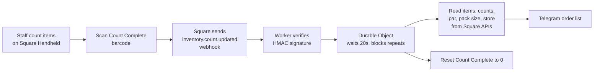

# Square Supply Alerts

A Cloudflare Worker that turns a Square stock count into a shopping list. Staff count supplies on a Square Handheld, scan one barcode when they finish, and about 20 seconds later the team gets a Telegram message listing what to buy, how many packs, and from which store.

Built for a small Florida cafe and bar that serves espresso drinks, pressed juices, and made-to-order food. Running in production since September 2026.

## The problem

Staff were getting sent to purchase inventory items mid-shift because supplies ran out, and produce was spoiling on the shelf. The manager had attempted to associate inventory items to items on the menu so that inventory would react to sales being made, but it drifted badly because sandwiches use fractions of an ingredient (a leaf of lettuce, part of a tomato). Square has no good way to deduct "a quarter of a tomato."

Counting what is actually on the shelf works better than predicting it from sales. This project makes counting fast and turns each count into an order list automatically.

## How it works



1. Supply items live in Square as regular catalog items in one of two categories: **Supplies - Weekly** (dry goods, cups, milk) or **Supplies - Produce**. They have stock tracking on, a low-stock threshold, and are marked not sellable.
2. Staff count each item with Square's built-in Inventory Re-Count screen.
3. When done, they scan a barcode for a special **Count Complete** item. Its stock goes from 0 to 1, which fires an `inventory.count.updated` webhook.
4. The Worker verifies the webhook signature, ignores every event except a Count Complete at 1 or more, and hands off to a Durable Object for that group.
5. The Durable Object waits 20 seconds (so any last counts finish syncing), then builds the list:
   - Finds every item in the group's category
   - Reads **par**, **pack size**, and **store** from Square custom attributes, and the low-stock threshold from the item variation
   - For anything at or below its threshold: `buy = par - on hand`, rounded **up** to whole packs, grouped by store
6. It sends the list to a Telegram group and resets Count Complete to 0.

A daily cron also checks for overdue counts and for a Count Complete stuck at 1 (which means a run failed).

### Example message

```
🛒 Produce order list

Store A
  Onions (each): 1 on hand, par 8, buy 7

Store B
  Lettuce (head): 2 on hand, par 6, buy 4

Double-check these counts:
  Limes (each) (no change in 9 days)

Needs setup in Square:
  Tomatoes (each): Par is empty
```

## Design decisions

**Counting instead of recipes.** Per-sale ingredient deduction can't handle partial produce use. A shelf count is always right, and a stray mistake corrects itself at the next count.

**Configuration lives in Square, not in code.** Par, pack size, and store are Square custom attributes, and the Worker finds items by category. The owner adds a new supply item entirely from the Square Dashboard, with no code change or redeploy.

**Two independent groups.** Dry goods are counted weekly, produce about every three days. Each group has its own Count Complete item, its own Durable Object, and its own overdue and "stale count" timing, so one never blocks the other.

**Durable Object for timing and de-duplication.** Webhooks can arrive more than once. One Durable Object per location and group sets an alarm and ignores repeat triggers while a run is pending. This replaced a plain `setTimeout`, which a Worker can't rely on after it returns a response.

**Nothing fails silently.** Items missing a par, missing a threshold, or with a threshold at or above par show up in a "Needs setup" section. Items that haven't changed in a while get a "double-check these counts" note. If a run throws, the group gets an error alert instead of nothing.

**No retail mode needed.** Square's Stock Counts screen requires switching the POS to retail mode, which would change checkout for every sale. Using Manage Stock plus one barcode scan works in restaurant mode.

**Telegram over ntfy.** The first version used ntfy, which rate-limits shared Cloudflare IP addresses. Telegram's bot API has no such issue and is free.

**$0 per month.** Runs on the Cloudflare Workers free plan (SQLite-backed Durable Objects included), Square webhooks, and Telegram.

## Security

- Every webhook is checked with HMAC-SHA256 over the webhook URL plus the raw body, using a timing-safe comparison. Unsigned or altered requests get a 403.
- All tokens and keys are stored as Wrangler secrets, never in code or config.
- The Telegram bot URL (which contains the token) is never logged.
- Sandbox and production are separate Wrangler environments with separate Square apps, IDs, and secrets.

## Setup

You need a Square developer account, a Cloudflare account, and a Telegram bot.

1. Clone the repo and install Wrangler:
   ```bash
   npm install
   ```
2. Copy the example config and fill in your own values:
   ```bash
   cp wrangler.example.jsonc wrangler.jsonc
   ```
   You need your Cloudflare account ID, Square location ID, the Count Complete variation IDs for each group, and your Worker URL.
3. In Square, create:
   - The two supply categories
   - Three custom attribute definitions on items: `par` (number), `pack_size` (number), `store` (selection)
   - A Count Complete item in each category, not sellable, with stock tracking on
4. Set the secrets for each environment:
   ```bash
   npx wrangler secret put SQUARE_ACCESS_TOKEN --env sandbox
   npx wrangler secret put SQUARE_WEBHOOK_SIGNATURE_KEY --env sandbox
   npx wrangler secret put TELEGRAM_BOT_TOKEN --env sandbox
   npx wrangler secret put TELEGRAM_CHAT_ID --env sandbox
   ```
5. Deploy:
   ```bash
   npx wrangler deploy --env sandbox
   ```
6. In the Square Developer Dashboard, add a webhook subscription for `inventory.count.updated` pointing at `https://<your-worker>/square-webhook`. The URL must match `WEBHOOK_URL` exactly or signatures won't verify.

Test everything in Sandbox before deploying to production.

## Testing

Tested in Square Sandbox and then end to end on the real POS with a handheld scan:

- Valid signature accepted, unsigned request rejected (403)
- Correct items listed, pack rounding correct, items above threshold skipped, grouped by store
- Weekly and produce lists stay separate; scanning both sends two correct messages
- Double scan produces one message
- An item added only through the Dashboard shows up on the next list
- Missing par is flagged under "Needs setup"
- Receiving stock does not trigger a list

## Lessons learned

- **An empty ID can silently return everything.** A helper that looked up an item by name returned an empty ID, and Square's batch-retrieve treated that as "all items at this location." Lookups now fail loudly on zero or multiple matches.
- **`batch-upsert` replaces the whole object.** Editing an item without repeating every variation field (SKU, price, sellable flag) wipes them. Always send the full object with its current `version`.
- **Custom attribute values come back as text.** Numbers arrive as `"12.0"` and selection fields arrive as a UID that has to be looked up in the definition.
- **Setting a count to the same value fires no webhook.** Matters when testing.
- **Durable Object bindings and migrations aren't inherited** by Wrangler environments. Each environment needs its own.
- **Telegram group IDs change** if a group is upgraded to a supergroup, which silently breaks alerts.

## Roadmap

- Recalculate par levels from real usage: `usage = last count + received - wasted - this count`, averaged over several weeks, with a smaller safety buffer for perishables
- Unit tests for the order math and a GitHub Actions workflow to run them

## Tech

JavaScript, Cloudflare Workers, Durable Objects (alarms), Cron Triggers, Square Catalog, Inventory, and Webhooks APIs, Telegram Bot API.
